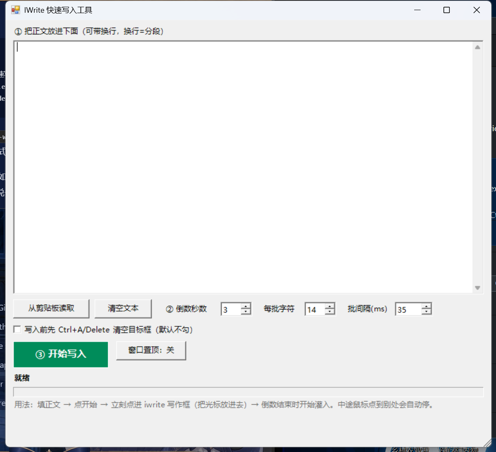

# iwrite-typer · 批量文本快速写入工具

> 把一大段文本**以模拟键盘的方式**瞬间敲进当前光标所在的输入框——不经过剪贴板，因此能绕过 iwrite 爱写作这类「复制粘贴：不开启」的网页编辑器限制。




---

## 目录

- [为什么需要它](#为什么需要它)
- [功能](#功能)
- [快速开始](#快速开始)
- [参数说明](#参数说明)
- [工作原理](#工作原理)
- [常见问题](#常见问题)
- [已知限制](#已知限制)
- [English](#english)
- [免责声明](#免责声明)

---

## 为什么需要它

在线写作平台（如 iwrite 爱写作）常用「禁用粘贴」来防代写。它们拦截的是 `paste` 事件和剪贴板 API，**而不是键盘**。

本工具直接调用 Win32 `SendInput`，把文本拆成 Unicode 字符事件逐个送入系统输入队列。对浏览器而言，这和一个人在飞快打字没有任何区别：1500 字符约需 5–10 秒，肉眼几乎只看到文字瞬间填满。

## 功能

- **零依赖**：只用 Windows 自带的 Windows PowerShell 5.1，不需要 Python / Node / AutoHotkey，也不需要管理员权限
- **不碰剪贴板**：不受任何粘贴限制影响，也不会覆盖你剪贴板里的内容
- **批量高速**：每个字符 down/up 两个事件打包进一次 `SendInput` 调用，默认 14 字符/批
- **自动分段**：文本里的换行会被转为回车键，段落结构原样保留
- **焦点保护**：每批写入前校验前台窗口是否仍是最初的目标窗口，你一旦点到别处立即停止并显示进度
- **空目标保护**：若开始后检测到前台窗口还是工具自己（说明你还没点进目标框），直接取消，绝不乱打
- **可调节奏**：倒数秒数、每批字符数、批间隔都可调，慢速模式也能伪装成人工打字
- **绝不提交**：不点任何页面按钮，不碰标题栏，只往当前光标处输出字符

## 快速开始

### 1. 启动

双击 **`IWriteTyper.vbs`**（静默启动，不会闪黑框）。

> `.vbs` 被安全策略禁用时，改用 **`IWriteTyper.cmd`**。

想放到桌面：右键 `IWriteTyper.vbs` → 发送到 → 桌面快捷方式。

### 2. 填入文本

把正文粘进上方大文本框，或点「从剪贴板读取」。

换行 = 分段。空行会被保留为一个空段落。

### 3. 开始写入

1. 点绿色按钮 **③ 开始写入**
2. 在倒数的几秒内**点一下目标输入框**，把光标放进去
3. 倒数结束 → 文本开始灌入 → 状态栏显示实时进度

写完状态栏会显示「完成：写入 N 字符，用时 X 秒」。

## 参数说明

| 参数 | 默认值 | 说明 |
|---|---|---|
| **倒数秒数** | 3 | 留给你点进目标输入框的时间。手慢可调到 5–10 |
| **每批字符** | 14 | 单次 `SendInput` 发送的字符数。越小越稳，越大越快 |
| **批间隔 (ms)** | 35 | 每批之间的停顿。想更"像人打字"就调大到 80–200 |
| **写入前先 Ctrl+A/Delete 清空目标框** | 关 | 勾选后先清空目标框再写，防止追加在旧内容后面 |
| **窗口置顶** | 关 | 打开后工具窗口会盖住目标，一般不需要 |

## 工作原理

```
文本框 ──► 按段落切分 ──► 按 N 字符分块
                              │
                              ▼
                     SendInput(2N 个 INPUT)
                  type=INPUT_KEYBOARD
                  wScan=字符, dwFlags=KEYEVENTF_UNICODE
                              │
                              ▼
                       系统输入队列 ──► 前台窗口
```

几个关键点：

- **`INPUT` 结构在 x64 下必须是 40 字节**（`[StructLayout(LayoutKind.Explicit, Size = 40)]`）。按常见的 32 字节声明会导致 `SendInput` 静默失败——返回 0 且不报错，这是最容易踩的坑。
- 每个字符发两个事件（down + up），数组一次性提交，减少系统调用次数。
- 换行 → `VK_RETURN (0x0D)`；清空 → `Ctrl+A` + `VK_DELETE`。
- 纯 WinForms 界面 + 单文件 PowerShell，不需要编译，改一行就能跑。

## 常见问题

**Q：完全没反应？**
A：
